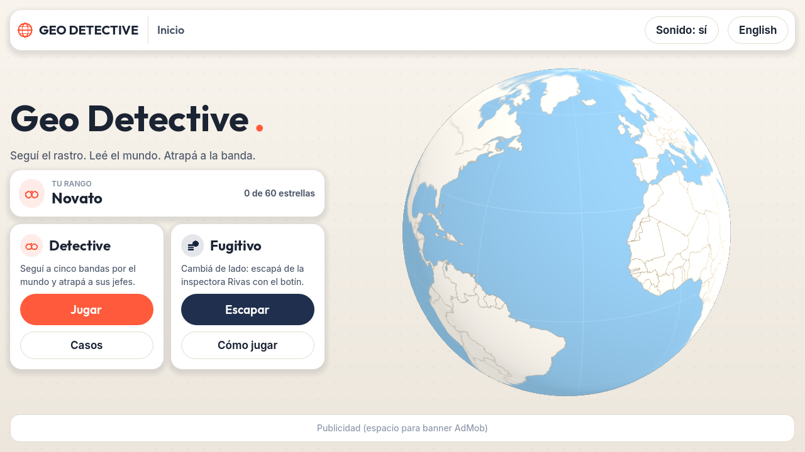
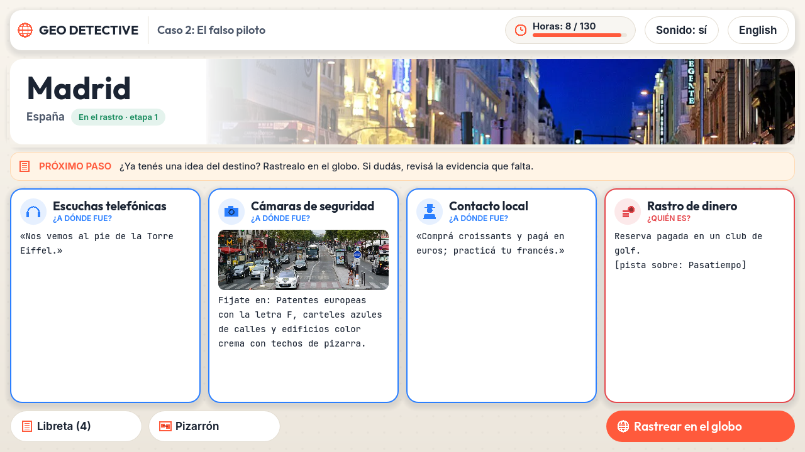
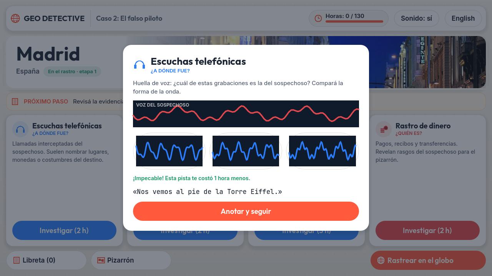
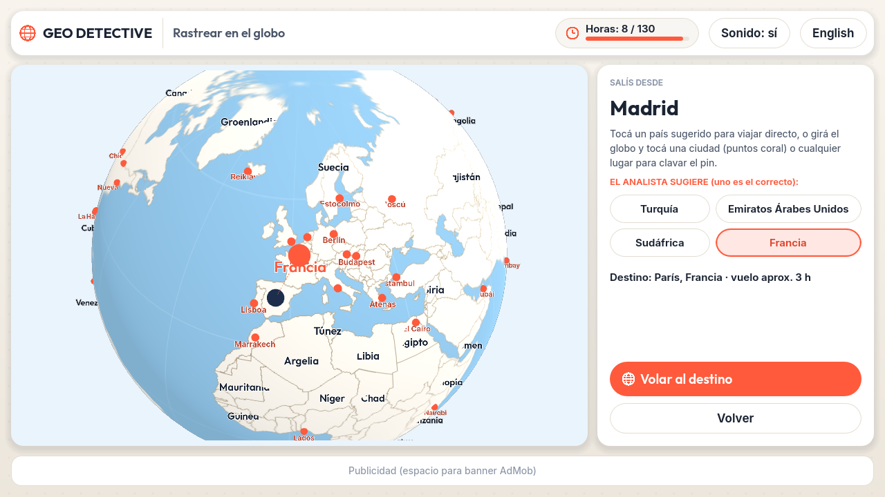
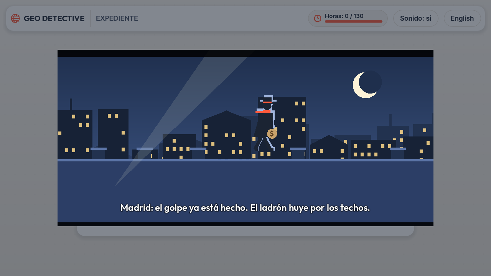
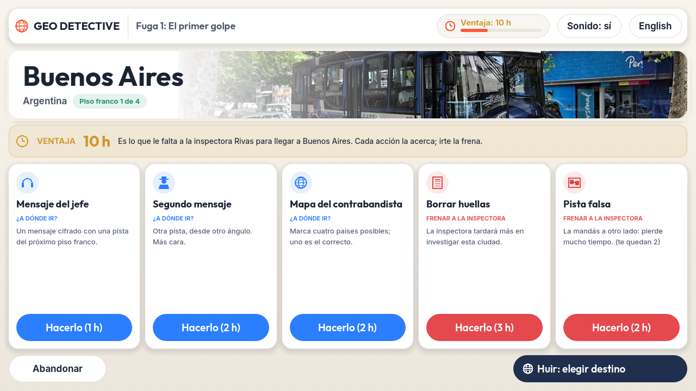
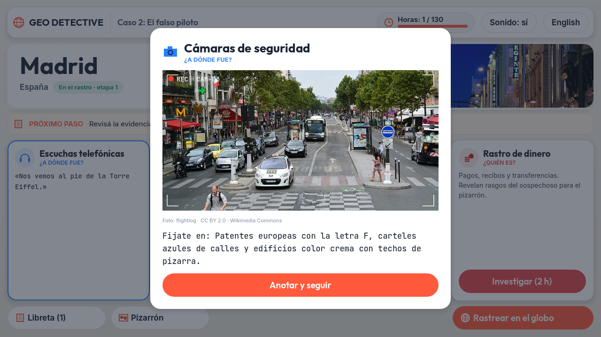
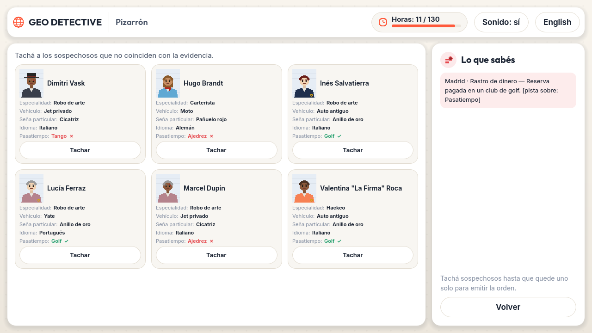

# Geo Detective *(working title)*

> An original 3D-arcade geography detective game with **two modes**: chase gangs around the world as a detective — or switch sides and escape an AI inspector as the thief.
> Built with **Godot 4** for **PC, Android, iOS and Web**. Free with ads, one-time purchase to remove them.

**Status:** 🟡 Alpha — two full modes playable (15 cases + 5 escapes), modern UI, interactive clues, cutscenes and sound.

## Screenshots
| | |
|---|---|
|  |  |
|  |  |
|  |  |
|  |  |

*Rendered automatically by `game/tests/screenshot_tour.gd` (xvfb + OpenGL).*

## Why this project
A portfolio project documented end to end: design, technical decisions, development log, testing and store release. Every significant decision is recorded in [`docs/decisions/`](docs/decisions/) and every work session in [`docs/devlog/`](docs/devlog/).

## Features (v1)
- **Two modes:** *Detective* (15 cases) and *Fugitive* (5 escapes against an AI inspector who closes in as you spend time)
- 15 hand-crafted cases across 5 gangs, routes of 4–11 cities, saved progress and detective ranks
- Stylized low-poly 3D globe + arcade/retro UI
- **Pin-drop pursuit** on a labelled 3D globe with marked cities — or travel by picking one of the analyst's four countries
- **Four evidence sources** per city: wiretaps, CCTV street photos (easy GeoGuessr-style), a local contact and the money trail
- **Corkboard** deduction: cross out suspects, issue the arrest order
- **Arrest finales**: car chase, canal boat chase or rooftop foot chase (keyboard, swipe or tap)
- **Interactive evidence** with 8 mini-games: tune a radio, match a voiceprint, focus CCTV, interrogate contacts, order transactions…
- **Cutscenes** with a recurring thief character and **action events** (sightings, passport control)
- Original synthesized **sound effects**; modern light UI (Outfit / Inter)
- Built-in guidance: *How to play*, a *Next step* box and a notebook split into *Where?* / *Who?*
- Spanish & English
- Ads banner (AdMob) + "Remove ads" in-app purchase
- Targets: Windows/Linux, Android, iOS, Web (itch.io)

## Repository layout
| Path | Content |
|---|---|
| `game/` | Godot 4 project |
| `tools/` | Python tooling (case/level validation, build scripts) |
| `docs/design/` | Game Design Document |
| `docs/decisions/` | Architecture Decision Records (ADRs) |
| `docs/devlog/` | Development diary |
| `task_plan.md`, `progress.md`, `findings.md` | Live project plan & progress |

## Originality & IP
This is an original work. It belongs to the *geography/detective* genre, but its name, characters, story, art, music, text and levels are created from scratch for this project. See [ADR-0003](docs/decisions/0003-originality-policy.md).

---

## 🇪🇸 Resumen en español
Juego original de detectives y geografía, con gráficos 3D estilo arcade, hecho en **Godot 4** para PC, Android, iOS y web. Tiene **dos modos**: como detective perseguís a redes criminales por el mundo; como **fugitivo** sos el ladrón y escapás de una inspectora controlada por el juego. En modo detective revisás escuchas, rastros de dinero y cámaras de seguridad, **clavás un pin en un globo 3D** para seguirlos, tachás sospechosos en un pizarrón de corcho y terminás con una persecución arcade. La v1 tiene 15 casos (niveles), español e inglés, anuncios y una compra única para quitarlos. Todo el desarrollo queda documentado (decisiones, diario y plan) como proyecto de portfolio.

## Play the latest build
▶️ **https://ftagliaferro.github.io/Geo-Detective/** — built and deployed automatically by GitHub Actions on every push to `main`.

## Development
```bash
# Validate content (Python 3.10+)
python3 tools/validate_data.py
python3 -m unittest discover -s tools/tests

# Game logic tests (Godot 4.4.1)
godot --headless --path game --import
godot --headless --path game --script res://tests/run_tests.gd

# UI tests: smoke test of every screen, then every chip/city/case played through the real UI
godot --headless --path game --script res://tests/smoke_ui.gd
godot --headless --path game --script res://tests/ui_flows.gd
```
